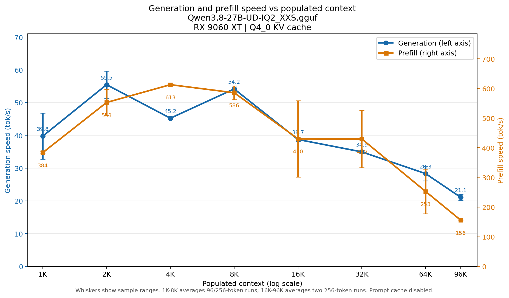

# llama.cpp - AMD optimizations

This fork is based on [Ajay9o9's llama.cpp fork](https://github.com/Ajay9o9), which targeted CUDA. It adapts that work for AMD GPU inference through ROCm/HIP, particularly DSpine speculative decoding on RDNA4 (`gfx1200`). The project remains based on [upstream llama.cpp](https://github.com/ggml-org/llama.cpp).

The chart below shows measured generation and prompt-prefill speed as the populated conversation grows from 1K to 96K tokens. Generation speed uses the left axis; prefill speed uses the right axis. It was measured with Qwen3.8-27B-UD-IQ2_XXS.gguf, DSpine speculation, and Q4_0 target KV cache. The smaller-context points average 96- and 256-token runs; the larger-context points average two 256-token runs. Whiskers show the observed sample range.



## Optimizations

- **Fused recurrent-state gathers:** read Gated Delta Net (GDN) state directly from the cache, avoiding intermediate gather buffers.
- **Fused GDN convolution:** combine state gathering, convolution-state updates, depthwise convolution, and SiLU into one kernel for supported small batches.
- **RDNA4 matrix-vector tuning:** adjust quantized matrix-vector kernel launch geometry for multi-token speculative verification.
- **Smaller initial attention workspace:** grow temporary workspace with populated KV instead of reserving it for the full configured context. This preserves KV capacity and prompt batch sizing while reducing memory pressure in supported single-sequence speculative contexts.
- **Recurrent-state graph cleanup:** skip empty state-copy operations.
- **Diagnostics and regression coverage:** optional HIP allocation accounting, Windows DXGI memory-budget telemetry, graph timing, benchmark tools, and workspace-growth tests.

Development and benchmarking focus on Windows with an AMD Radeon RX 9060 XT 16 GB. See the [DSpine/ROCm investigation](docs/development/dspine-rocm-cliff.md) for measurements, validation status, and remaining limitations.

## Measured improvement

On the RX 9060 XT 16 GB with Qwen3.8-27B-UD-IQ2_XXS and its DSpine draft, reducing the initial attention workspace removed a severe verification slowdown:

| At 131072 configured context, speculative width 15 | Original reservation | Optimized reservation |
|---|---:|---:|
| Generation throughput | 23.0 tok/s | 39.7 tok/s (+72%) |
| Steady target verification | 194 ms | 94 ms |
| Target temporary workspace | 780 MiB | 191 MiB |

This paired comparison used `-b 2048 -ub 512 --spec-draft-n-ubatch 32`, Flash Attention, Q4_0 target KV, and FP16 draft KV. Output and acceptance counts were identical. With the fix, width 6 remained faster on this workload at approximately **48 tok/s**, so it is the recommended starting point.

These are synchronized profiling measurements of a short prompt and 256 generated tokens, not a fully populated 131K conversation. The comparison isolates workspace reservation, not the combined benefit of every kernel optimization. Available Windows GPU memory budget affects the result. Convolution fusion was disabled with `GGML_CUDA_GDN_FUSION=0`; default-fusion performance was not measured in this comparison.

## Run the server

Download the model pair:

- [Main model: Qwen3.8-27B-UD-IQ2_XXS.gguf](https://huggingface.co/unsloth/Qwen3.8-27B-GGUF/blob/main/Qwen3.8-27B-UD-IQ2_XXS.gguf)
- [Drafter: Qwen3.8-27B-DSpine-b16-Q4_K_M.gguf](https://huggingface.co/aj9o9/Qwen3.8-27B-DSpine-b16-GGUF/blob/main/Qwen3.8-27B-DSpine-b16-Q4_K_M.gguf)

After building this fork with HIP support, run the following from the repository root in **PowerShell 7**. This is the launcher configuration expressed as a normal command; change the two model paths for your machine.

```powershell
.\build-rocm\bin\llama-server.exe `
  -m "D:\40-49 Assets\44 AI Models\Qwen3.8-27B-UD-IQ2_XXS.gguf" `
  --model-draft "D:\40-49 Assets\44 AI Models\Qwen3.8-27B-DSpine-b16-Q4_K_M.gguf" `
  -np 1 -lv 4 --n-gpu-layers all --load-mode none `
  -fa on -t 8 -b 2048 -ub 512 `
  --cache-type-k q4_0 --cache-type-v q4_0 --ctx-size 131072 `
  --temp 0.6 --top-p 0.95 --top-k 20 --min-p 0.0 `
  --presence-penalty 0.0 --repeat-penalty 1.0 `
  --reasoning on --reasoning-effort low --jinja `
  --chat-template-kwargs '{"reasoning_effort":"low"}' `
  --spec-type draft-dflash --spec-draft-n-max 6 `
  --spec-draft-type-k f16 --spec-draft-type-v f16 `
  --spec-draft-n-ubatch 32 `
  -n -1 --host 127.0.0.1 --port 9090 `
  --alias Qwen3.8-27B-UD-IQ2_XXS
```

Open <http://127.0.0.1:9090> for the web interface, or use the OpenAI-compatible API at <http://127.0.0.1:9090/v1>.

The most important tuning parameters are:

| Parameter | Purpose |
|---|---|
| `--ctx-size 131072` | Reserves conversation capacity; actual populated context still determines attention work. |
| `--spec-draft-n-max 6` | Limits draft length. Width 6 was faster than 9, 12, or 15 on the benchmark prompt, even after removing the memory cliff. |
| `--spec-draft-n-ubatch 32` | Keeps the draft context's temporary buffers small. |
| `-b 2048 -ub 512` | Sets logical batch capacity and the maximum physical microbatch size. Larger microbatches can require more workspace. |
| Target `q4_0` / draft `f16` KV | Saves target-cache memory while keeping the measured draft-cache precision. |
| `-fa on --n-gpu-layers all` | Enables Flash Attention and requests full GPU offload. |

The command uses the default convolution-fusion setting. To reproduce the measurements above, set `$env:GGML_CUDA_GDN_FUSION = '0'` before starting it. The workspace optimization itself is enabled by default in this fork.

## Documentation

- [Build instructions](docs/build.md#hip)
- [Server usage](tools/server/README.md)
- [Benchmark results](docs/development/dspine-rocm-cliff-results.json)
- [Upstream llama.cpp](https://github.com/ggml-org/llama.cpp)

This fork retains the upstream [MIT license](LICENSE).
